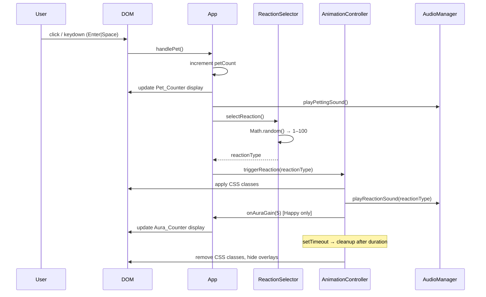

# Design Document

## Overview

Cat Clicker is a zero-dependency, single-HTML-file web application. The entire implementation — markup, styles, and logic — ships in one `index.html` file that a user can open directly in a browser with no server or build step. Tailwind CSS is loaded from CDN, and custom animations are injected via the `tailwind.config` object before the CDN script tag. All interactivity is written in Vanilla JavaScript with no external libraries.

The core interaction loop is:

1. User clicks (or keyboard-activates) the Cat element.
2. `Reaction_Selector` rolls a 1–100 integer and maps it to one of four reactions.
3. `Animation_Controller` applies/removes CSS classes on the Cat.
4. `Audio_Manager` plays the appropriate sound(s).
5. Counters (`Pet_Counter`, `Aura_Counter`) update in the DOM.
6. After a reaction-specific timeout, the animation is cleaned up.

---

## Architecture

The application is a single HTML file with three logically separated concerns:

```
index.html
├── <head>
│   ├── Tailwind config (tailwind.config object + CDN script)
│   ├── Google Fonts link
│   └── Custom <style> block (zzz-fade keyframe fallback, frosted-glass helpers)
├── <body>
│   ├── Counter bar (Pet_Counter + Aura_Counter)
│   ├── Cat container
│   │   ├── Zzz overlay element
│   │   ├── Speed-line emojis (Zoomies)
│   │   ├── SVG cat element
│   │   └── Overlay_Text element (Happy reaction)
│   └── <script>
│       ├── AudioManager module
│       ├── AnimationController module
│       ├── ReactionSelector module
│       └── App bootstrap (event listeners, counter state)
```

### Component interaction diagram



---

## Components and Interfaces

### AudioManager

Responsible for creating `Audio()` objects and playing/stopping them safely.

```js
// Expected audio files (drop replacements alongside index.html):
// - pet.mp3      (petting sound, short pop/meow)
// - purr.mp3     (looping purr, 2-second clip)
// - zoom.mp3     (zoom or boing sound effect)

const AudioManager = (() => {
  const sounds = {
    pet:  new Audio('pet.mp3'),
    purr: new Audio('purr.mp3'),
    zoom: new Audio('zoom.mp3'),
  };

  function play(name, loop = false) { /* ... */ }
  function stop(name) { /* ... */ }

  return { play, stop };
})();
```

**Interface:**
- `AudioManager.play(name, loop?)` — plays the named sound; catches Promise rejections silently; sets `loop` before play when `loop=true`.
- `AudioManager.stop(name)` — pauses the named sound and resets `currentTime` to 0.

### AnimationController

Manages the lifecycle of a single active reaction. Only one reaction runs at a time; starting a new one cancels the previous timer and removes its classes.

```js
const AnimationController = (() => {
  let activeTimer = null;
  let cleanupFn   = null;

  function cancel() { /* clearTimeout + cleanupFn() */ }
  function trigger(reactionType, onAuraGain) { /* ... */ }

  return { trigger, cancel };
})();
```

**Interface:**
- `AnimationController.trigger(reactionType, onAuraGain)` — cancels any active reaction, applies the appropriate classes, sets a timeout to remove them. Calls `onAuraGain(5)` immediately for Happy reactions.
- `AnimationController.cancel()` — stops the active timer and runs the pending cleanup immediately.

### ReactionSelector

Pure function that maps a 1–100 integer to a reaction type string.

```js
const ReactionSelector = (() => {
  function select(rng = () => Math.floor(Math.random() * 100) + 1) {
    const n = rng();
    if (n <= 40)  return 'happy';
    if (n <= 70)  return 'purring';
    if (n <= 90)  return 'sleeping';
    return 'zoomies';
  }

  return { select };
})();
```

**Interface:**
- `ReactionSelector.select(rng?)` — accepts an optional RNG function for testability; defaults to `Math.random()`-based uniform integer in [1, 100].

### App (bootstrap)

Holds mutable counter state, wires DOM event listeners, and coordinates the three modules.

```js
let petCount  = 0;
let auraScore = 0;

function handlePet() {
  petCount++;
  updateCounterUI();
  AudioManager.play('pet');
  const reaction = ReactionSelector.select();
  AnimationController.trigger(reaction, (delta) => {
    auraScore += delta;
    updateCounterUI();
  });
}
```

---

## Data Models

All state is held in memory in plain JavaScript variables. There is no persistence layer (local storage, IndexedDB, or server). State resets on page reload.

### AppState

| Field       | Type     | Initial value | Description                                   |
|-------------|----------|---------------|-----------------------------------------------|
| `petCount`  | `number` | `0`           | Total number of pets since page load           |
| `auraScore` | `number` | `0`           | Accumulated Aura points from Happy reactions   |

### ReactionType (enum-style string union)

| Value       | Roll range | Duration  | Aura delta |
|-------------|-----------|-----------|------------|
| `'happy'`   | 1–40      | 1 000 ms  | +5         |
| `'purring'` | 41–70     | 2 000 ms  | 0          |
| `'sleeping'`| 71–90     | 2 000 ms  | 0          |
| `'zoomies'` | 91–100    | 1 500 ms  | 0          |

### AnimationConfig (per-reaction)

Each reaction maps to a configuration object used by `AnimationController`:

```js
const REACTION_CONFIG = {
  happy: {
    catClasses:    ['animate-bounce'],
    overlayText:   'YAY! 😊 (+5 Aura)',
    showOverlay:   true,
    duration:      1000,
    auraGain:      5,
    sound:         null,
    soundLoop:     false,
  },
  purring: {
    catClasses:    ['animate-pulse'],
    overlayText:   '',
    showOverlay:   false,
    duration:      2000,
    auraGain:      0,
    sound:         'purr',
    soundLoop:     true,
  },
  sleeping: {
    catClasses:    ['scale-90', 'rotate-6'],
    overlayText:   '',
    showOverlay:   false,
    showZzz:       true,
    duration:      2000,
    auraGain:      0,
    sound:         null,
    soundLoop:     false,
  },
  zoomies: {
    catClasses:    ['animate-wiggle'],
    overlayText:   '',
    showOverlay:   false,
    showSpeedLines: true,
    duration:      1500,
    auraGain:      0,
    sound:         'zoom',
    soundLoop:     false,
  },
};
```

### DOM Element References

| Variable        | Selector / id       | Purpose                               |
|-----------------|---------------------|---------------------------------------|
| `catEl`         | `#cat`              | SVG cat element; receives CSS classes |
| `petCounterEl`  | `#pet-counter`      | Displays "Total Pets: {n} 🐾"         |
| `auraCounterEl` | `#aura-counter`     | Displays "Aura: {n} ✨"               |
| `overlayEl`     | `#overlay-text`     | Happy reaction text overlay           |
| `zzzEl`         | `#zzz`              | Sleeping reaction Zzz emoji           |
| `speedLinesEl`  | `#speed-lines`      | Zoomies 💨 emoji container            |

---

## Correctness Properties

*A property is a characteristic or behavior that should hold true across all valid executions of a system — essentially, a formal statement about what the system should do. Properties serve as the bridge between human-readable specifications and machine-verifiable correctness guarantees.*

### Property 1: Pet counter always increments by exactly 1

*For any* initial pet count value and any valid user interaction (click, tap, Enter, or Space on the Cat), the pet count after the interaction SHALL be exactly one more than the pet count before the interaction.

**Validates: Requirements 3.1**

### Property 2: Reaction selection is exhaustive and partition-complete

*For any* integer `n` in [1, 100], `ReactionSelector.select(() => n)` SHALL return exactly one of `'happy'`, `'purring'`, `'sleeping'`, or `'zoomies'`. The four ranges [1–40], [41–70], [71–90], [91–100] SHALL cover every integer in [1, 100] with no gaps and no overlaps.

**Validates: Requirements 4.1, 4.2, 4.3, 4.4, 4.5**

### Property 3: Aura score increases by exactly 5 on Happy, never changes on other reactions

*For any* non-negative initial aura score and any reaction type, the aura score after triggering the reaction SHALL equal `initialAura + 5` when the reaction type is `'happy'`, and SHALL equal `initialAura` for all other reaction types.

**Validates: Requirements 5.3**

### Property 4: Reaction selector defaults to Happy on invalid RNG output

*For any* RNG function that throws an exception, or returns a value outside [1, 100] (including `NaN`, `Infinity`, `null`, `0`, `101`, or any non-numeric value), `ReactionSelector.select` SHALL return `'happy'`.

**Validates: Requirements 4.7**

### Property 5: AnimationController removes prior reaction classes before applying new ones

*For any* two reaction types triggered in succession (the second before the first reaction's timeout expires), the Cat element's class list at the moment the second reaction starts SHALL contain none of the CSS classes belonging to the first reaction.

**Validates: Requirements 4.6**

### Property 6: Counter display format invariant

*For any* non-negative integer `n` in [0, 999,999,999], `formatPetCounter(n)` SHALL return a string exactly matching `"Total Pets: " + n + " 🐾"`, and `formatAuraCounter(n)` SHALL return a string exactly matching `"Aura: " + n + " ✨"`.

**Validates: Requirements 3.3, 5.5**

### Property 7: Audio replay always starts from the beginning

*For any* audio asset, any number of play/stop cycles, calling `AudioManager.play` after `AudioManager.stop` SHALL always result in `currentTime` being reset to `0` before the new `play()` call is made.

**Validates: Requirements 10.4**

### Property 8: Audio play() rejection is always suppressed silently

*For any* audio asset whose `play()` method returns a rejected Promise (due to autoplay policy, missing file, or any other reason), the rejection SHALL be caught and swallowed such that no unhandled Promise rejection is propagated and the application continues to operate normally.

**Validates: Requirements 10.2, 3.5, 6.4, 8.6**

---

## Error Handling

| Failure scenario | Component | Handling |
|---|---|---|
| `pet.mp3` / `purr.mp3` / `zoom.mp3` missing or fetch-blocked | `AudioManager.play()` | `.catch(() => {})` on the Promise returned by `audio.play()` — silently swallowed, app continues |
| Browser autoplay policy rejects `play()` | `AudioManager.play()` | Same Promise-catch suppression |
| `Math.random()` returns unexpected value | `ReactionSelector.select()` | Default branch returns `'happy'` |
| Active reaction timer still running when new pet fires | `AnimationController.trigger()` | `cancel()` called first: `clearTimeout`, cleanup function runs synchronously |
| Google Fonts CDN unavailable | Browser CSS cascade | `font-family` fallback chain ends in `sans-serif`; app remains fully functional |
| Tailwind CDN unavailable | Browser render | App layout degrades gracefully; custom inline styles cover critical layout |

---

## Testing Strategy

### Unit tests

The `ReactionSelector` and counter format functions are pure and straightforward to test with example-based unit tests:

- Boundary values for reaction ranges: roll = 1, 40, 41, 70, 71, 90, 91, 100.
- Off-by-one checks: roll = 0, 101.
- Default fallback: RNG throws, returns `NaN`, or returns `null`.
- Counter formatting: `n = 0`, `n = 1`, `n = 999999999`.

`AudioManager` is tested with mocks for `Audio()`:
- Confirm `.catch()` is attached after every `.play()` call.
- Confirm `currentTime` is reset to 0 before replay.
- Confirm `loop` is set before the `.play()` call for purr.

`AnimationController` is tested with a fake `document` / class-list mock:
- Triggering a reaction adds the correct classes and sets the correct timeout.
- Triggering a second reaction before the first expires removes the first reaction's classes.

### Property-based tests (using [fast-check](https://github.com/dubzzz/fast-check))

Each property test runs a minimum of 100 iterations.

**Property 1 — Pet counter increments by 1**
- Generator: arbitrary non-negative integer `petCount` in [0, 999999998].
- Assert: `handlePet(state).petCount === state.petCount + 1`.
- Tag: `Feature: cat-clicker, Property 1: Pet counter always increments by exactly 1`

**Property 2 — Reaction selection is exhaustive**
- Generator: arbitrary integer in [1, 100].
- Assert: return value is one of the four reaction strings; for each sub-range the correct reaction is returned.
- Tag: `Feature: cat-clicker, Property 2: Reaction selection is exhaustive and partition-complete`

**Property 3 — Aura delta correctness**
- Generator: arbitrary non-negative integer `auraScore`, arbitrary `reactionType` from the four values.
- Assert: `auraScore + (type === 'happy' ? 5 : 0) === result`.
- Tag: `Feature: cat-clicker, Property 3: Aura increases by exactly 5 on Happy, never changes otherwise`

**Property 4 — Fallback on invalid RNG**
- Generator: RNG functions that throw, return `NaN`, return `Infinity`, return 0, or return 101.
- Assert: `ReactionSelector.select(badRng) === 'happy'`.
- Tag: `Feature: cat-clicker, Property 4: Reaction selector falls back to Happy on invalid RNG output`

**Property 5 — No residual CSS classes after reaction switch**
- Generator: arbitrary sequence of two reaction types (may be the same).
- Assert: after triggering the second reaction, `catEl.classList` contains none of the first reaction's classes.
- Tag: `Feature: cat-clicker, Property 5: AnimationController cancels previous reaction before starting a new one`

**Property 6 — Counter format invariant**
- Generator: arbitrary integer in [0, 999999999].
- Assert: formatted string matches exact template patterns.
- Tag: `Feature: cat-clicker, Property 6: Counter display format invariant`

**Property 7 — Audio replay starts from the beginning**
- Generator: arbitrary number of play/stop cycles (1–10) for each of the three sound assets.
- Assert: `currentTime === 0` immediately before each `play()` call that follows a `stop()`.
- Tag: `Feature: cat-clicker, Property 7: Audio replay always starts from the beginning`

**Property 8 — Audio play() rejection is suppressed**
- Generator: each of the three audio assets; play() mock that rejects with arbitrary errors (network error, autoplay policy, etc.).
- Assert: no unhandled Promise rejection is thrown; `petCount` / `auraScore` state is unaffected.
- Tag: `Feature: cat-clicker, Property 8: Audio play() rejection is always suppressed silently`

### Integration / smoke tests

- Open `index.html` in a headless browser (e.g., Playwright); confirm the page renders without JS errors.
- Click the Cat 10 times; confirm `petCount` reaches 10 in the DOM.
- Confirm Tailwind CDN loads and `animate-bounce` class is defined.
- Confirm Google Fonts loads or fallback font renders without layout collapse.
